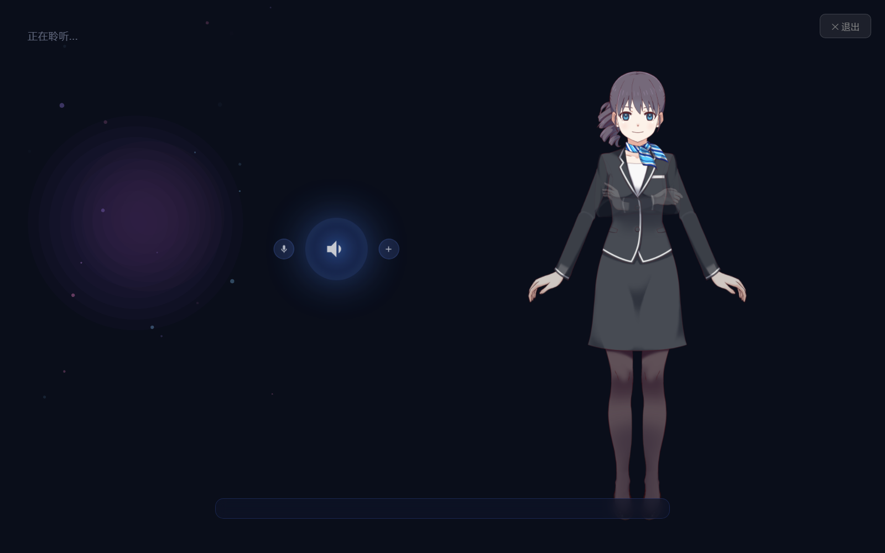
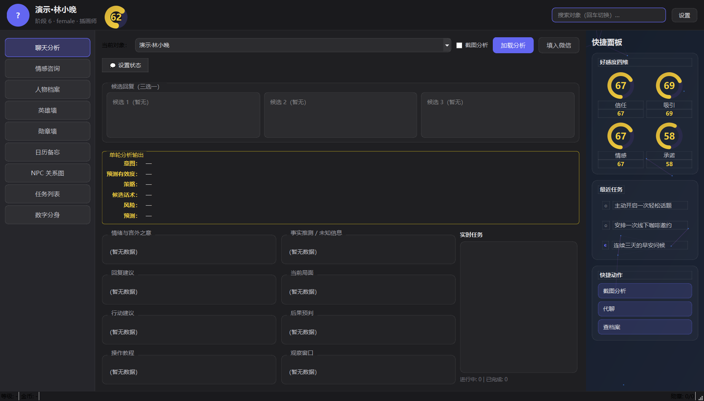
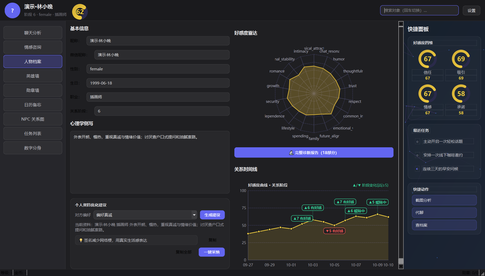
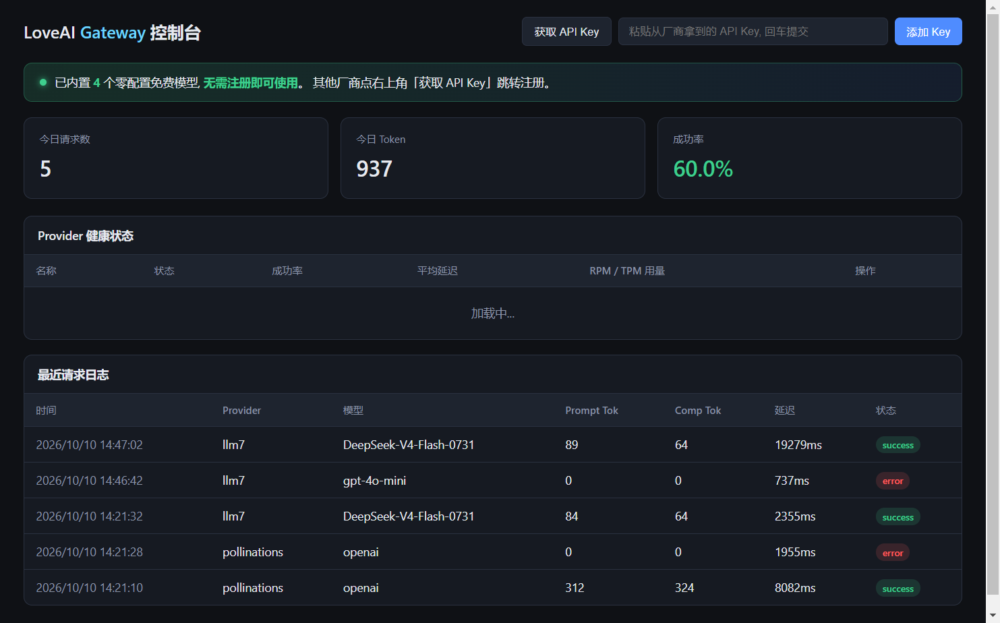
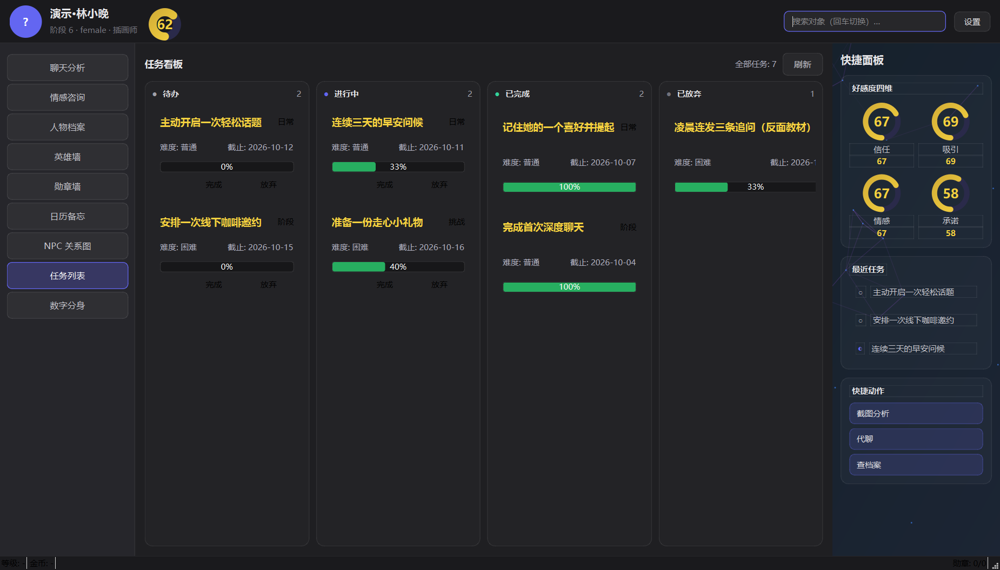
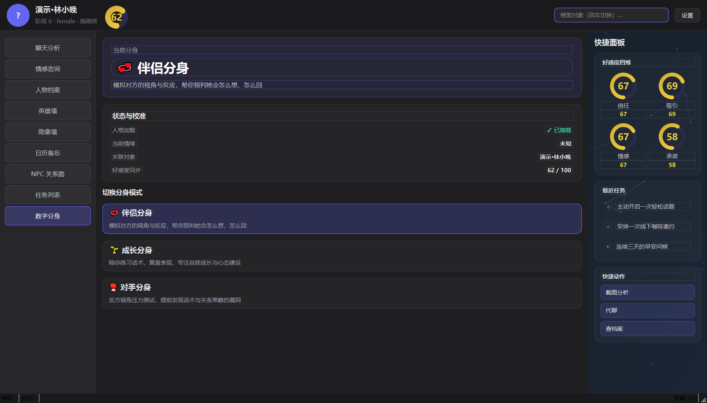
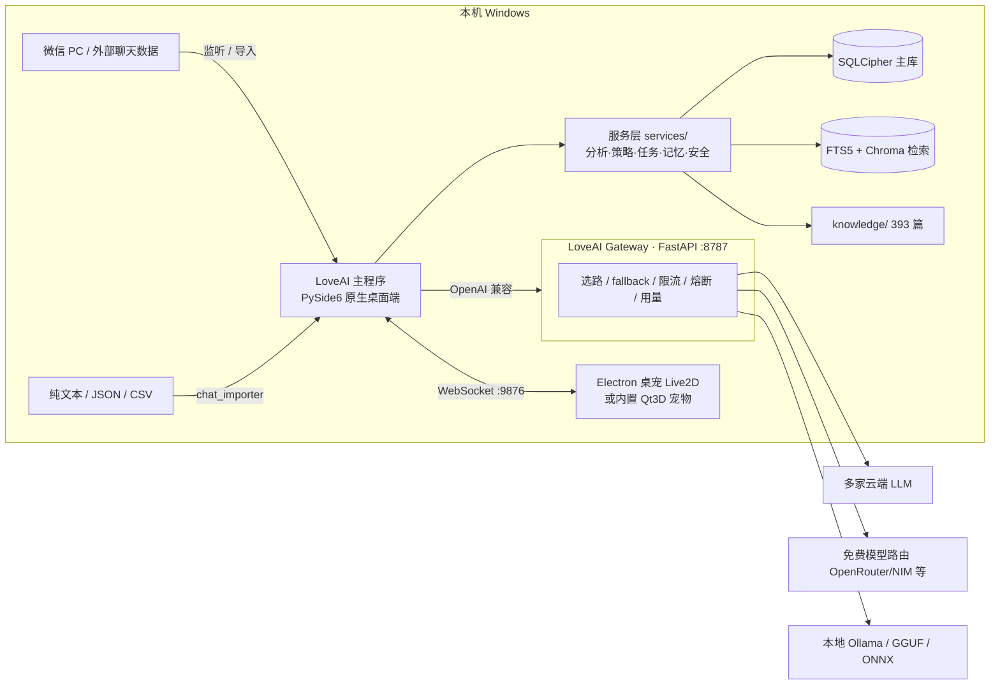

<div align="center">

# LoveAI

**地球online恋爱小游戏——游戏化 AI 恋爱指导助手（现实增强·数字恋人是预测工具）**

> **定位**：本软件主打**与真实的人产生互动**——增强现实、回归现实。桌面桌宠/数字分身是你的**关系分析助手**（预测工具），用于判断真实关系、提供话术反馈、展示关系数据；**不是恋爱对象**。一切分析最终都回归到帮你**与真实的人建立更好的互动**。

<!-- 顶部 badge 行：坐标为 GitHub 占位，发布前全局替换为真实 owner/repo -->

[](LICENSE)
[](requirements.txt)
[](#)
[](https://github.com/LoveAI-team/LoveAI/actions/workflows/ci.yml)
[](https://github.com/LoveAI-team/LoveAI/releases)
[](CONTRIBUTING.md)

**[中文](README.md) · [English](README_en.md)**

</div>

---

## 演示截图

> 以下均为真实运行截图，统一存放于 `docs/screenshots/`。

| 沉浸式陪伴主视觉 | 主界面 | 人物档案 |
| :---: | :---: | :---: |
|  |  |  |
| 立绘 + 语音球 + 字幕 | 原生 PySide6 桌面端 + 右侧快捷面板 | 18 维雷达 + 时间线 + 资料建议 |

| 网关暗色控制台 | 桌面桌宠 | 任务看板 |
| :---: | :---: | :---: |
|  |  |  |
| FastAPI `:8787` 单文件控制台 | Electron + Live2D / 内置 Qt3D | 四列看板 + 进度 + 反面教材 |

| 数字分身（伴侣/成长/对手） | 对话气泡（浅色壁纸） |
| :---: | :---: |
|  |  |
| 三模式切换 + 状态校准 | 深色毛玻璃气泡 + 动作联动 |

---

## 这是什么

LoveAI 是一个 **Windows 桌面端、本地优先（local-first）、隐私可控** 的「游戏化 AI 恋爱指导助手」。它把恋爱与亲密关系经营做成一款「地球 Online」小游戏：

- **接入并分析真实聊天记录**——以微信 PC 为主，同时支持纯文本 / JSON / CSV 导入，**不依赖微信密钥**；
- **用大模型 + 心理学体系生成结构化洞察**——人物档案、关系阶段、情绪与好感度、策略建议、游戏化任务；
- **常驻桌面的虚拟桌宠**——Electron + Live2D（或主程序内置 Qt3D 程序化骨骼宠物）作为拟人化陪伴与反馈入口；
- **独立的多模型聚合网关**——聚合多家云端 / 免费 / 本地模型，OpenAI 兼容，业务代码零改动接入。

### 边界（如实说明，不承诺没有的东西）

- 主要面向 **Windows**（依赖 pywin32、微信 PC、Windows API）；macOS / Linux 未作为一等目标，但**网关本身跨平台**。
- **没有独立 Android / iOS App**，「手机端」目前仅为接口 / 规划预留。
- 不替用户做道德决策；内置敏感词替换 / 云端拒绝检测 / 本地降级的安全过滤，但**不保证任何具体关系结果**。
- **Live2D Cubism Core 并非开源**（Live2D 专有许可，小营收规模可免费）；需要 100% 开源路线时，请使用主程序内置的 **Qt3D 程序化骨骼宠物**。

---

## 核心特性

每条特性都有真实模块支撑，括号内为对应服务层 / 组件：

1. **人物侧写 / 六维人设** — `persona_analyzer`、`six_layer_persona`、`six_dim_strategy` 生成可复制的高阶「人物档案」（CHARACTER FILE），含关系阶段标签、好感度 0–100、星级、情绪折线、当前策略卡与危险信号。
2. **关系阶段与承诺追踪** — `cycle_service`、`commitment_tracker`、`relationship_graph` 识别关系阶段、双向投入与承诺兑现，并可视化关系图谱。
3. **18 维好感度引擎** — `affection_engine` 实时更新、衰减、快照，配合环形 / 雷达图直观呈现。
4. **游戏化任务与勋章** — `task_engine` 把建议拆成可执行分步任务并判定推进；`medal_service` 内置 25+ 勋章与英雄墙，像打游戏一样经营关系。
5. **多模型聚合网关（组件二）** — FastAPI、OpenAI 兼容；自动选路 / fallback / 限流 / 熔断 / 用量统计 / Key AES-256-GCM 加密；暗色仪表盘；内置 34 家主流厂商免费注册引导。
6. **四级模型路由 + 免费通道** — 主程序 `llm_gateway` 降级链 = 付费云端(L3) → 免费模型路由(OpenRouter `:free` / NVIDIA NIM 等) → 本地 GGUF(L2, Qwen2.5-0.5B + LoRA) → 本地小模型(L1, smollm2-135m ONNX) → 规则兜底；支持本地 Ollama。
7. **数字分身模拟** — `digital_twin` / `digital_human` / `twin_sim_pipeline` / `review_loop` 预测对方反应、模拟回复、与真实结果对比并滚动校准（方向罗盘 9 维指标）。
8. **情绪分析与安全过滤** — `emotion_analyzer`、`mood_service` 识别情绪 / 强度 / 疑问 / 回复速度；`safety_filter` 负责敏感词替换、云端拒绝检测、本地降级。
9. **隐私优先 / 老板键** — 本地优先，聊天库 SQLCipher 加密；默认不上传匿名数据；一键老板键 `Ctrl+Alt+H`；锁屏可隐藏桌宠。
10. **双形态桌宠（组件三）** — Electron + Live2D / PixiJS 透明置顶常驻、气泡说话、表情联动；或主程序内置全开源 Qt3D 程序化骨骼宠物；WebSocket（`9876`）实时驱动。
11. **本地知识库 RAG** — `rag_service` 用 FTS5 + Chroma 双引擎融合检索 `knowledge/`（实测 393 篇），惰性导入 + 硬超时。
12. **语音 / OCR / 财务 / 记忆 / 备份** — 语音转写与 TTS、截屏 OCR（RapidOCR）、财务信号与风险档、长期记忆 fact/lesson、zip 备份恢复。

---

## 快速开始

### 前置要求

- Windows 10 / 11（x64）；
- Python **3.11 或 3.12**（安装时勾选 *Add to PATH*）；
- Node.js 18+（**仅** Electron 桌宠需要，实测 Node v22 / npm 10）；
- Git。

### 一键安装（推荐，Windows）

1. 克隆后双击 **`install.bat`**：创建 `.venv` → 安装主程序 `requirements.txt` → 安装 `gateway/requirements.txt` → 在 `desktop-pet-electron` 执行 `npm install`。幂等，可重复运行。
2. 双击 **`start.bat`**：先在 `:8787` 启动网关，再启动主程序（主程序会经 `pet_launcher` 自动拉起桌宠）。
3. 首次打开在设置 / 引导里配置一个可用模型（云端 API Key，或走网关仪表盘，或启用本地模型）。

### 手动命令（跨平台 / 开发者，PowerShell 语法）

```powershell
# 在仓库根目录 $ROOT 下
python -m venv .venv
.\.venv\Scripts\python.exe -m pip install --upgrade pip
.\.venv\Scripts\python.exe -m pip install -r requirements.txt
.\.venv\Scripts\python.exe -m pip install -r gateway\requirements.txt
Push-Location desktop-pet-electron; npm install; Pop-Location

# 终端 A：启动网关（监听 127.0.0.1:8787）
Push-Location gateway
..\.venv\Scripts\python.exe -m uvicorn app.main:app --host 127.0.0.1 --port 8787
Pop-Location

# 终端 B：启动主程序（会自动尝试拉起桌宠）
.\.venv\Scripts\python.exe .\main.py

# 终端 C（可选，单独跑桌宠）
Push-Location desktop-pet-electron; npm start; Pop-Location
```

- **网关控制台**：<http://127.0.0.1:8787/>
- **OpenAI 兼容基址**：`http://127.0.0.1:8787/v1`
- 主程序让网关生效：把 OpenAI 兼容基址指向 `http://127.0.0.1:8787/v1`（网关未设 `gateway_api_key` 时 `api_key` 随便填一个非空值）。
- 本地模型（不随仓库分发）：`.\.venv\Scripts\python.exe .\tools\download_models.py`。

### 测试 / 打包

```powershell
# 测试：在 $ROOT 执行（当前收集到 1636 个用例；旧文档的「242」已过时）
.\.venv\Scripts\python.exe -m pytest
# 快速回归（排除慢用例）
.\.venv\Scripts\python.exe -m pytest -m "not slow"

# 网关独立测试：在 gateway 目录执行
Push-Location gateway; pytest; Pop-Location

# 打包主程序（PyInstaller）
.\.venv\Scripts\python.exe -m PyInstaller LoveAI.spec --noconfirm

# 打包桌宠（Windows 产物在其 dist/）
Push-Location desktop-pet-electron; npm run build:win; Pop-Location
```

---

## 技术栈

| 层 | 技术选型 |
| :--- | :--- |
| 桌面端 | Python 3.11+ · **PySide6**（原生 QWidget；v3.0 起无 QWebEngine）· **Qt3D**（内置宠物） |
| 数据层 | **SQLAlchemy 2.x** · **SQLCipher（sqlcipher3）** · SQLite FTS5 · **ChromaDB** · NumPy / Pillow |
| 网关 | **FastAPI + Uvicorn + Pydantic 2** · httpx · PyYAML · cryptography · Docker / docker-compose（可选） |
| 桌宠 | **Electron 30 + PixiJS 7 + pixi-live2d-display**（Live2D Cubism moc3）· electron-builder · Node.js 18+ |
| AI / 检索 / 感知 | openai SDK · httpx · playwright · onnxruntime · tokenizers · opencv-python · rapidocr-onnxruntime · websocket-client |
| 工程化 | pytest · PyInstaller（`LoveAI.spec`） |

---

## 项目架构

```
LoveAI-v2/
├── main.py                 # 【主程序入口】PySide6 原生 QWidget 桌面端（v3.0 起移除 QWebEngine，含 Qt3D 宠物）
├── config.json             # 默认配置：LLM / 微信 / 隐私 / 快捷键 / 窗口 / 后台
├── requirements.txt        # 主程序 Python 依赖
├── app/                    # 应用层：窗口、托盘、快捷键、WebSocket 桌宠服务、生命周期
│   ├── application.py      # LoveAIApplication：服务注册、日志轮转、生命周期
│   ├── pet_launcher.py     # 启动时自动拉起 Electron 桌宠（优先打包 exe，否则 npm start）
│   ├── pet_ws_server.py    # 桌宠 WebSocket 服务端（默认端口 9876）
│   ├── qt3d_pet/           # 内置全开源 Qt3D 程序化骨骼宠物（skeleton/animations/pet_view/gltf_loader）
│   └── widgets/            # 原生 QWidget 各窗口与通用控件（雷达图/关系图/任务卡/好感度环等）
├── services/               # 服务层：100+ 个纯 Python 业务模块（不依赖 PySide6）
├── models/                 # 数据层：SQLAlchemy 模型 / 建表
├── gateway/                # 【组件二】多模型聚合网关（FastAPI，OpenAI 兼容，端口 8787）
│   ├── app/main.py         # FastAPI 入口 + lifespan + 后台目录采集
│   ├── app/core/engine.py  # 选路 / fallback / 限流 / 熔断
│   ├── app/providers/      # 各厂商适配器 + registry + key 自动识别
│   ├── app/routes/         # chat / models / admin 路由
│   ├── app/web/dashboard.html # 单文件暗色控制台
│   ├── config.example.yaml / Dockerfile / docker-compose.yml / requirements.txt
├── desktop-pet-electron/   # 【组件三】Electron 桌宠（Live2D + PixiJS，WebSocket 连主程序 9876）
│   ├── electron/ renderer/ config/ assets/ package.json
├── knowledge/              # 本地知识库：实测 393 个 Markdown
├── prompts/                # LLM Prompt 模板（chat_analysis/digital_twin/emotion_consult/profile_generation/reply_style/task_generation）
├── plugins/ skills/        # 插件 / 技能扩展（由 plugin_service 扫描加载隔离）
├── assets/ resources/ styles/ ui/
├── data/                   # 运行期数据：loveai.db(SQLCipher) / unified_search.db(FTS5) / chroma_db / backups / window_state
├── models_local/           # 本地模型（不随仓库分发，单独下载）
├── logs/ backups/ ollama_data/ tests/ tools/ docs/ scripts/
└── .venv/                  # 本地虚拟环境（不入库）
```



---

## 功能清单（三大组件覆盖）

| 模块 | 能力 | 对应目录 / 服务 |
| :--- | :--- | :--- |
| **主程序入口** | PySide6 原生 QWidget 桌面端、生命周期、日志轮转 | `main.py` · `app/application.py` |
| 窗口 / 控件 | 雷达图、关系图、任务卡、好感度环、托盘、老板键 | `app/widgets/` |
| 桌宠桥接 | 自动拉起 Electron 桌宠、WebSocket 服务端（9876） | `app/pet_launcher.py` · `app/pet_ws_server.py` |
| 内置宠物 | 全开源 Qt3D 程序化骨骼宠物（无需 Live2D） | `app/qt3d_pet/` |
| 聊天导入 | 微信 PC 监听 / 纯文本 / JSON / CSV 导入，不依赖密钥 | `services/`（chat_importer 等） |
| 人物档案 | 六维人设、关系阶段、好感度、策略卡、危险信号 | `services/`（persona_analyzer / six_*） |
| 关系引擎 | 关系阶段、承诺追踪、关系图谱 | `services/`（cycle_service / commitment_tracker / relationship_graph） |
| 好感度 | 18 维实时更新、衰减、快照 | `services/`（affection_engine） |
| 游戏化 | 分步任务推进、25+ 勋章、英雄墙 | `services/`（task_engine / medal_service） |
| 数字分身 | 反应预测、模拟回复、复盘校准 | `services/`（digital_twin / twin_sim_pipeline / review_loop） |
| 情绪与安全 | 情绪/强度识别、敏感词替换、云端拒绝检测、本地降级 | `services/`（emotion_analyzer / mood_service / safety_filter） |
| 检索 / 记忆 | FTS5 + Chroma 双引擎 RAG、长期记忆 fact/lesson | `services/`（rag_service 等）· `knowledge/` |
| **多模型网关** | 选路 / fallback / 限流 / 熔断 / 用量统计、Key 加密、暗色控制台 | `gateway/app/main.py` · `gateway/app/core/engine.py` |
| 厂商适配 | 34+ 厂商适配器、registry、Key 自动识别、免费通道引导 | `gateway/app/providers/` |
| 网关路由 | chat / models / admin，OpenAI 兼容 | `gateway/app/routes/` |
| **Electron 桌宠** | Live2D / PixiJS 透明置顶、气泡、表情联动、WS 驱动 | `desktop-pet-electron/` |
| 插件 / 技能 | 隔离扫描加载 | `plugins/` · `skills/` |
| 数据持久化 | SQLCipher 主库、FTS5、Chroma、备份 | `models/` · `data/` |

> 说明：`services/` 为不依赖 PySide6 的纯 Python 业务模块集合（实测 100+ 个）；上表按能力归类列出关键服务名，完整清单见源码。

---

## 常见问题（FAQ）

**Q：是否收费？**
开源免费（AGPL-3.0）。你可以走免费模型通道，也可以自带云端 API Key；启用本地模型时零 API 费用。

**Q：支持 Mac 或手机吗？**
一等目标是 **Windows**；网关本身跨平台。独立 Android / iOS App 属于远期规划，目前「手机端」仅为接口预留。

**Q：必须登录或联网吗？**
不必须。本地优先，可全程走本地模型离线运行；只有调用云端模型时才需要联网与对应 API Key。

**Q：我的聊天数据安全吗？**
聊天库在本机用 SQLCipher 加密存储，默认不上传任何匿名数据，并支持一键 zip 备份 / 恢复。

**Q：它会自动替我发消息吗？**
默认**不会**（`auto_send=false`）。所有对外发送都需要你本人确认。

**Q：和 Cherry Studio 是什么关系？**
网关 / 控制台设计参考了 Cherry Studio（AGPL-3.0）的实现，但本项目聚焦「游戏化恋爱指导」，**不是** Cherry Studio 的分叉。

**Q：AGPL 与 Live2D 许可是怎么回事？**
本项目代码以 AGPL-3.0 发布；其中 Live2D Cubism Core 为专有许可（小团队 / 小营收规模可在其免费门槛内使用）。如果你需要纯开源方案，直接使用主程序内置的 Qt3D 程序化骨骼宠物即可。

---

## Roadmap

### 已完成

- 原生 PySide6 桌面端（v3.0 起移除 QWebEngine）；
- 人物档案 / 关系阶段 / 18 维好感度 / 游戏化任务与勋章；
- 多模型聚合网关与免费模型路由；
- 数字分身模拟与复盘校准；
- SQLCipher 隐私加密；
- Electron + Live2D 与内置 Qt3D 双形态桌宠；
- 本地知识库 RAG（393 篇）；
- 测试基线：**1636** 个用例。

### 进行中 / 计划

- 分发打包（绿色免安装、依赖随包）；
- 更多模型与免费通道接入；
- 语音 / 视觉增强；
- macOS / Linux 适配调研；
- 独立移动端（远期）；
- 多语言（i18n）；
- 社区模板市场。

---

## 参与贡献

我们欢迎各种形式的贡献——提交 Issue、修复 Bug、补充文档、分享模板，都能让这个项目更好。

- 贡献流程与规范：见 [CONTRIBUTING.md](CONTRIBUTING.md)
- 社区行为公约：见 [CODE_OF_CONDUCT.md](CODE_OF_CONDUCT.md)
- 上手捷径：见 [docs/QUICKSTART.md](docs/QUICKSTART.md)
- 更新日志：见 [CHANGELOG.md](CHANGELOG.md)
- 网关说明：见 [gateway/README.md](gateway/README.md)
- 桌宠说明：见 [desktop-pet-electron/README.md](desktop-pet-electron/README.md)

---

## 许可证

本项目以 **GNU AGPL-3.0-only** 许可证发布，全文见 [LICENSE](LICENSE)。

- 网关 / 控制台的设计参考了 [Cherry Studio](https://github.com/CherryHQ/cherry-studio)（AGPL-3.0）；本项目聚焦「游戏化恋爱指导」，并非其分叉。
- **Live2D Cubism Core** 归 Live2D 专有许可所有（小营收规模可免费）；需要纯开源路线时请用内置 Qt3D 宠物。
- 各上游开源依赖（PySide6、FastAPI、SQLAlchemy、Electron、PixiJS 等）请遵循其各自的开源许可证。

---

## Star History

<a href="https://star-history.com/#LoveAI-team/LoveAI&Timeline"></a>

### 致谢

感谢所有上游开源项目与社区贡献者。LoveAI 的多模型网关与暗色控制台设计受 Cherry Studio 启发；桌宠渲染基于 Live2D / PixiJS 生态；本地知识库与心理学提示体系来自社区共同积累。如果这个项目对你有帮助，欢迎点个 Star ⭐。
