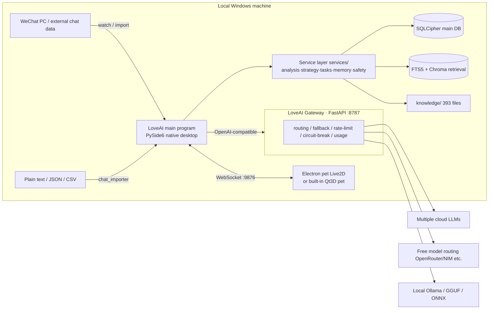

<div align="center">

# LoveAI

**Earth Online: Love Game — Gamified AI Dating Coach**

> **Positioning**: This product is built to help you interact with **real people** — augmenting real life, returning to real life. The desktop pet / digital twin is your **relationship analysis assistant** (a prediction tool): it judges real relationships, gives feedback on your lines, and displays relationship data; it is **not a romantic partner**. Every analysis ultimately serves one goal — helping you build better interactions with **real people**.

<!-- Top badge row: GitHub coordinates are placeholders; replace globally with the real owner/repo before release -->

[](LICENSE)
[](requirements.txt)
[](#)
[](https://github.com/LoveAI-team/LoveAI/actions/workflows/ci.yml)
[](https://github.com/LoveAI-team/LoveAI/releases)
[](CONTRIBUTING.md)

**[中文](README.md) · [English](README_en.md)**

</div>

---

## Screenshots / Demo

> Visual assets are added later by a dedicated asset agent; placeholders are kept for now. All screenshots live under `docs/screenshots/`. Until the files land, `` tags with captions are retained — no fake external hotlinked images.

| Hero / demo GIF | Main window | Character file |
| :---: | :---: | :---: |
|  |  |  |
| *`docs/screenshots/demo.gif`* | Native PySide6 desktop app | Six-layer persona + affection ring |

| Gateway dashboard | Desktop pet | Tasks & medals |
| :---: | :---: | :---: |
|  |  |  |
| FastAPI `:8787` single-file dashboard | Electron + Live2D / built-in Qt3D | Gamified tasks + 25+ medals |

---

## What is LoveAI

LoveAI is a **Windows desktop, local-first, privacy-controllable** "gamified AI dating coach". It turns dating and intimate-relationship management into an "Earth Online" mini-game:

- **Ingests and analyzes real chat logs** — primarily WeChat on PC, with plain-text / JSON / CSV import also supported; **no WeChat token required**;
- **Uses LLMs + psychology frameworks to produce structured insights** — character profile, relationship stage, emotion & affection, strategy advice, gamified tasks;
- **A always-on desktop pet** — Electron + Live2D (or the built-in Qt3D procedural skeleton pet) as an anthropomorphic companion and feedback entry point;
- **A standalone multi-model aggregation gateway** — aggregates multiple cloud / free / local models, OpenAI-compatible, plugged into business code with zero changes.

### Scope boundaries (stated honestly; no overpromising)

- Primarily targets **Windows** (relies on pywin32, WeChat PC, and Windows APIs). macOS / Linux are not first-class targets, **but the gateway itself is cross-platform**.
- **No standalone Android / iOS app**; the "mobile side" is currently reserved only as an interface / planning hook.
- It does not make moral decisions for you; it ships safety filtering (sensitive-word replacement, cloud-refusal detection, local fallback), but **it does not guarantee any particular relationship outcome**.
- **Live2D Cubism Core is not open source** (Live2D proprietary license, free for small revenue). If you need a 100% open-source route, use the built-in **Qt3D procedural skeleton pet** instead.

---

## Core features

Each feature is backed by a real module; the bracketed names point to the corresponding service / component:

1. **Character profiling / six-layer persona** — `persona_analyzer`, `six_layer_persona`, `six_dim_strategy` produce a copyable high-level "character file" (CHARACTER FILE) with relationship-stage tags, affection 0–100, star rating, emotion line, current strategy card, and red flags.
2. **Relationship stage & commitment tracking** — `cycle_service`, `commitment_tracker`, `relationship_graph` identify relationship stages, two-way investment and commitment fulfillment, and visualize the relationship graph.
3. **18-dimension affection engine** — `affection_engine` updates, decays, and snapshots in real time, visualized with ring / radar charts.
4. **Gamified tasks & medals** — `task_engine` splits advice into executable step-by-step tasks and judges progress; `medal_service` ships 25+ medals and a hall of fame, so you run your relationship like a game.
5. **Multi-model aggregation gateway (component 2)** — FastAPI, OpenAI-compatible; automatic routing / fallback / rate-limiting / circuit-breaking / usage stats / Key AES-256-GCM encryption; dark dashboard; built-in free-signup guidance for 34 mainstream vendors.
6. **Four-tier model routing + free channels** — the main program's `llm_gateway` fallback chain = paid cloud (L3) → free model routing (OpenRouter `:free` / NVIDIA NIM, etc.) → local GGUF (L2, Qwen2.5-0.5B + LoRA) → local small model (L1, smollm2-135m ONNX) → rule-based fallback; local Ollama is supported.
7. **Digital twin simulation** — `digital_twin` / `digital_human` / `twin_sim_pipeline` / `review_loop` predict the other party's reactions, simulate replies, compare with real outcomes, and calibrate over time (9-dim direction compass).
8. **Emotion analysis & safety filtering** — `emotion_analyzer`, `mood_service` recognize emotion / intensity / questions / reply speed; `safety_filter` handles sensitive-word replacement, cloud-refusal detection, and local degradation.
9. **Privacy-first / boss key** — local-first; chat store encrypted with SQLCipher; anonymous data is not uploaded by default; one-click boss key `Ctrl+Alt+H`; the pet can be hidden on lock screen.
10. **Dual-form desktop pet (component 3)** — Electron + Live2D / PixiJS transparent always-on-top, speech bubbles, expression linkage; or the built-in fully open-source Qt3D procedural skeleton pet; driven in real time over WebSocket (`9876`).
11. **Local knowledge-base RAG** — `rag_service` uses FTS5 + Chroma dual-engine hybrid retrieval over `knowledge/` (393 files measured), lazy import with a hard timeout.
12. **Voice / OCR / finance / memory / backup** — speech transcription & TTS, screenshot OCR (RapidOCR), financial signals & risk profile, long-term fact/lesson memory, zip backup & restore.

---

## Quick start

### Prerequisites

- Windows 10 / 11 (x64);
- Python **3.11 or 3.12** (tick *Add to PATH* during install);
- Node.js 18+ (**only** needed for the Electron pet; tested on Node v22 / npm 10);
- Git.

### One-click install (recommended, Windows)

1. After cloning, double-click **`install.bat`**: creates `.venv` → installs the main program's `requirements.txt` → installs `gateway/requirements.txt` → runs `npm install` in `desktop-pet-electron`. Idempotent and safe to re-run.
2. Double-click **`start.bat`**: starts the gateway on `:8787` first, then launches the main program (which auto-spawns the pet via `pet_launcher`).
3. On first run, configure a working model in settings / onboarding (a cloud API Key, or via the gateway dashboard, or enable a local model).

### Manual commands (cross-platform / developers, PowerShell syntax)

```powershell
# From the repository root $ROOT
python -m venv .venv
.\.venv\Scripts\python.exe -m pip install --upgrade pip
.\.venv\Scripts\python.exe -m pip install -r requirements.txt
.\.venv\Scripts\python.exe -m pip install -r gateway\requirements.txt
Push-Location desktop-pet-electron; npm install; Pop-Location

# Terminal A: start the gateway (listens on 127.0.0.1:8787)
Push-Location gateway
..\.venv\Scripts\python.exe -m uvicorn app.main:app --host 127.0.0.1 --port 8787
Pop-Location

# Terminal B: start the main program (it auto-attempts to spawn the pet)
.\.venv\Scripts\python.exe .\main.py

# Terminal C (optional): run the pet standalone
Push-Location desktop-pet-electron; npm start; Pop-Location
```

- **Gateway dashboard**: <http://127.0.0.1:8787/>
- **OpenAI-compatible base URL**: `http://127.0.0.1:8787/v1`
- To make the gateway take effect in the main program, point the OpenAI-compatible base URL at `http://127.0.0.1:8787/v1` (if the gateway has no `gateway_api_key` set, fill `api_key` with any non-empty value).
- Local models (not shipped with the repo): `.\.venv\Scripts\python.exe .\tools\download_models.py`.

### Tests / packaging

```powershell
# Tests: run from $ROOT (currently 1636 cases collected; the old "242" is outdated)
.\.venv\Scripts\python.exe -m pytest
# Quick regression (exclude slow tests)
.\.venv\Scripts\python.exe -m pytest -m "not slow"

# Gateway's own tests: run from the gateway directory
Push-Location gateway; pytest; Pop-Location

# Package the main program (PyInstaller)
.\.venv\Scripts\python.exe -m PyInstaller LoveAI.spec --noconfirm

# Package the pet (Windows output lands in its dist/)
Push-Location desktop-pet-electron; npm run build:win; Pop-Location
```

---

## Tech stack

| Layer | Selection |
| :--- | :--- |
| Desktop | Python 3.11+ · **PySide6** (native QWidget; no QWebEngine since v3.0) · **Qt3D** (built-in pet) |
| Data | **SQLAlchemy 2.x** · **SQLCipher (sqlcipher3)** · SQLite FTS5 · **ChromaDB** · NumPy / Pillow |
| Gateway | **FastAPI + Uvicorn + Pydantic 2** · httpx · PyYAML · cryptography · Docker / docker-compose (optional) |
| Pet | **Electron 30 + PixiJS 7 + pixi-live2d-display** (Live2D Cubism moc3) · electron-builder · Node.js 18+ |
| AI / retrieval / perception | openai SDK · httpx · playwright · onnxruntime · tokenizers · opencv-python · rapidocr-onnxruntime · websocket-client |
| Engineering | pytest · PyInstaller (`LoveAI.spec`) |

---

## Architecture

```
LoveAI-v2/
├── main.py                 # 【Entry】PySide6 native QWidget desktop (QWebEngine removed since v3.0; includes Qt3D pet)
├── config.json             # Default config: LLM / WeChat / privacy / hotkeys / window / background
├── requirements.txt        # Main program Python deps
├── app/                    # App layer: windows, tray, hotkeys, WebSocket pet service, lifecycle
│   ├── application.py      # LoveAIApplication: service registration, log rotation, lifecycle
│   ├── pet_launcher.py     # Auto-spawns the Electron pet on startup (packaged exe first, else npm start)
│   ├── pet_ws_server.py    # Pet WebSocket server (default port 9876)
│   ├── qt3d_pet/           # Built-in fully open-source Qt3D procedural skeleton pet (skeleton/animations/pet_view/gltf_loader)
│   └── widgets/            # Native QWidget windows & common controls (radar/relationship/task card/affection ring, etc.)
├── services/               # Service layer: 100+ pure-Python business modules (no PySide6 dependency)
├── models/                 # Data layer: SQLAlchemy models / table creation
├── gateway/                # 【Component 2】Multi-model aggregation gateway (FastAPI, OpenAI-compatible, port 8787)
│   ├── app/main.py         # FastAPI entry + lifespan + background catalog scan
│   ├── app/core/engine.py  # Routing / fallback / rate-limit / circuit-break
│   ├── app/providers/      # Vendor adapters + registry + auto key detection
│   ├── app/routes/         # chat / models / admin routes
│   ├── app/web/dashboard.html # Single-file dark dashboard
│   ├── config.example.yaml / Dockerfile / docker-compose.yml / requirements.txt
├── desktop-pet-electron/   # 【Component 3】Electron pet (Live2D + PixiJS, WebSocket to main program 9876)
│   ├── electron/ renderer/ config/ assets/ package.json
├── knowledge/              # Local knowledge base: 393 Markdown files measured
├── prompts/                # LLM prompt templates (chat_analysis/digital_twin/emotion_consult/profile_generation/reply_style/task_generation)
├── plugins/ skills/        # Plugin / skill extensions (scanned & isolated by plugin_service)
├── assets/ resources/ styles/ ui/
├── data/                   # Runtime data: loveai.db(SQLCipher) / unified_search.db(FTS5) / chroma_db / backups / window_state
├── models_local/           # Local models (not shipped with repo; downloaded separately)
├── logs/ backups/ ollama_data/ tests/ tools/ docs/ scripts/
└── .venv/                  # Local virtualenv (not committed)
```



---

## Feature map (all three components)

| Module | Capability | Directory / service |
| :--- | :--- | :--- |
| **Main entry** | PySide6 native QWidget desktop, lifecycle, log rotation | `main.py` · `app/application.py` |
| Windows / controls | Radar chart, relationship graph, task cards, affection ring, tray, boss key | `app/widgets/` |
| Pet bridge | Auto-spawn Electron pet, WebSocket server (9876) | `app/pet_launcher.py` · `app/pet_ws_server.py` |
| Built-in pet | Fully open-source Qt3D procedural skeleton pet (no Live2D needed) | `app/qt3d_pet/` |
| Chat import | WeChat PC watch / plain-text / JSON / CSV import, no token required | `services/` (chat_importer, etc.) |
| Character file | Six-layer persona, relationship stage, affection, strategy card, red flags | `services/` (persona_analyzer / six_*) |
| Relationship engine | Relationship stage, commitment tracking, relationship graph | `services/` (cycle_service / commitment_tracker / relationship_graph) |
| Affection | 18-dim real-time update, decay, snapshot | `services/` (affection_engine) |
| Gamification | Step-by-step task progress, 25+ medals, hall of fame | `services/` (task_engine / medal_service) |
| Digital twin | Reaction prediction, reply simulation, review & calibration | `services/` (digital_twin / twin_sim_pipeline / review_loop) |
| Emotion & safety | Emotion/intensity recognition, sensitive-word replacement, cloud-refusal detection, local fallback | `services/` (emotion_analyzer / mood_service / safety_filter) |
| Retrieval / memory | FTS5 + Chroma dual-engine RAG, long-term fact/lesson memory | `services/` (rag_service, etc.) · `knowledge/` |
| **Multi-model gateway** | Routing / fallback / rate-limit / circuit-break / usage stats, Key encryption, dark dashboard | `gateway/app/main.py` · `gateway/app/core/engine.py` |
| Vendor adapters | 34+ vendor adapters, registry, auto key detection, free-channel guidance | `gateway/app/providers/` |
| Gateway routes | chat / models / admin, OpenAI-compatible | `gateway/app/routes/` |
| **Electron pet** | Live2D / PixiJS transparent always-on-top, bubbles, expression linkage, WS-driven | `desktop-pet-electron/` |
| Plugins / skills | Isolated scan & load | `plugins/` · `skills/` |
| Persistence | SQLCipher main DB, FTS5, Chroma, backup | `models/` · `data/` |

> Note: `services/` is a collection of pure-Python business modules with no PySide6 dependency (100+ measured). The table above groups key services by capability; see the source for the full list.

---

## FAQ

**Q: Is it paid?**
Free and open-source (AGPL-3.0). You can use the free model channels, bring your own cloud API Key, or run local models with zero API cost.

**Q: Does it support Mac or phones?**
The first-class target is **Windows**; the gateway itself is cross-platform. A standalone Android / iOS app is a long-term plan; the "mobile side" is currently only reserved as an interface.

**Q: Do I have to log in or be online?**
No. It is local-first and can run fully offline with local models; only cloud model calls require internet access and the corresponding API Key.

**Q: Is my chat data safe?**
The chat store is encrypted on disk with SQLCipher, anonymous data is not uploaded by default, and one-click zip backup / restore is supported.

**Q: Will it send messages for me automatically?**
**No, by default** (`auto_send=false`). Every outbound send requires your own confirmation.

**Q: What is the relationship with Cherry Studio?**
The gateway / dashboard design draws on Cherry Studio (AGPL-3.0) implementations, but this project focuses on "gamified dating coaching" and is **not** a fork of Cherry Studio.

**Q: How do AGPL and the Live2D license work?**
This project's code is released under AGPL-3.0; Live2D Cubism Core is proprietary (usable within its free threshold for small teams / small revenue). If you need a purely open-source route, just use the built-in Qt3D procedural skeleton pet.

---

## Roadmap

### Completed

- Native PySide6 desktop (QWebEngine removed since v3.0);
- Character file / relationship stages / 18-dim affection / gamified tasks & medals;
- Multi-model aggregation gateway with free model routing;
- Digital twin simulation and review calibration;
- SQLCipher privacy encryption;
- Dual-form pets: Electron + Live2D and built-in Qt3D;
- Local knowledge-base RAG (393 files);
- Test baseline: **1636** cases.

### In progress / planned

- Distribution packaging (green portable install, bundled dependencies);
- More models and free channels;
- Voice / vision enhancements;
- macOS / Linux adaptation research;
- Standalone mobile app (long-term);
- Internationalization (i18n);
- Community template marketplace.

---

## Contributing

All forms of contribution are welcome — filing issues, fixing bugs, improving docs, and sharing templates all help the project.

- Contribution workflow & guidelines: see [CONTRIBUTING.md](CONTRIBUTING.md)
- Community code of conduct: see [CODE_OF_CONDUCT.md](CODE_OF_CONDUCT.md)
- Quick onboarding: see [docs/QUICKSTART.md](docs/QUICKSTART.md)
- Changelog: see [CHANGELOG.md](CHANGELOG.md)
- Gateway docs: see [gateway/README.md](gateway/README.md)
- Pet docs: see [desktop-pet-electron/README.md](desktop-pet-electron/README.md)

---

## License

This project is released under **GNU AGPL-3.0-only**; see the full text in [LICENSE](LICENSE).

- The gateway / dashboard design references [Cherry Studio](https://github.com/CherryHQ/cherry-studio) (AGPL-3.0); this project focuses on "gamified dating coaching" and is not its fork.
- **Live2D Cubism Core** is owned under Live2D's proprietary license (free for small revenue); for a purely open-source route, use the built-in Qt3D pet.
- Upstream open-source dependencies (PySide6, FastAPI, SQLAlchemy, Electron, PixiJS, etc.) are governed by their respective licenses.

---

## Star History

<a href="https://star-history.com/#LoveAI-team/LoveAI&Timeline"></a>

### Acknowledgements

Thanks to all upstream open-source projects and community contributors. LoveAI's multi-model gateway and dark dashboard design were inspired by Cherry Studio; the pet rendering builds on the Live2D / PixiJS ecosystem; the local knowledge base and psychology prompt system were accumulated by the community. If this project helps you, please give it a Star ⭐.
